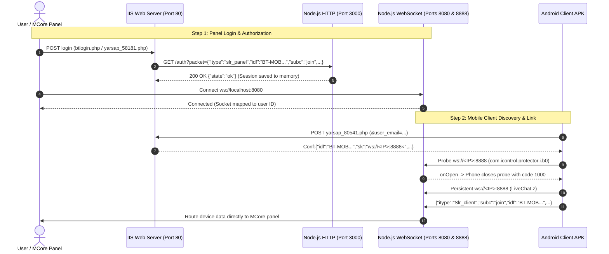

# Meterverscore2 Connection, Router, and WebSocket Troubleshooting Guide

This guide documents the full architecture, network handshake flow, known failure modes (specifically MikroTik router port hijacking and in-memory session loss), and permanent solutions for maintaining reliable connections between Android client APKs and the MCore desktop panel (`Meterverscore2`).

---

## 1. System Architecture & Connection Flow

The system consists of three main components:
1. **MCore Desktop Panel (VB.NET):**
   - The desktop management software running on Windows.
   - Connects locally to the WebSocket server over loopback (`localhost:8080` / `[::1]:8080`).
2. **Backend Services (IIS & Node.js):**
   - **IIS (Port 80):** Serves PHP API endpoints under `http://<Server_IP>/yaarsa/private/`.
   - **Node.js WebSocket Server (PM2 - `websocket-server.js`):**
     - HTTP API on **Port 3000** (`/auth`) for internal session authorization.
     - Dual-port WebSocket Server listening on **Port 8080** (for MCore) and **Port 8888** (for mobile clients).
3. **Android Client APK (`com.icontrol.protector`):**
   - Communicates initially over HTTP to obtain configuration, then maintains a persistent WebSocket connection.



---

## 2. Key Failure Modes & Permanent Solutions

### Issue A: MikroTik / Router Hijacking Port 8080

#### Symptom:
- Mobile devices never appear in MCore client list.
- Opening `http://10.0.0.32:8080` in Chrome on the mobile device loads the **MikroTik RouterOS WebFig Login** screen instead of returning `426 Upgrade Required`.
- PM2 out logs never show incoming connections from the phone's IP (`10.0.0.254`).

#### Root Cause:
MikroTik and several enterprise/home routers utilize port `8080` internally for WebFig administration, Web Proxy, or Hotspot redirection. Whenever client devices on Wi-Fi make outbound requests on TCP `8080`, the router intercepts the packets and serves its own web server instead of forwarding them to the PC.

#### Permanent Fix: Dual-Port WebSocket Server
Configure Node.js to listen on **both Port 8080 and Port 8888**:
- **Port 8080:** Used for MCore desktop panel connecting locally over `localhost` / `[::1]` (loopback never reaches the physical router).
- **Port 8888:** Used for mobile devices on the network. MikroTik does not intercept port 8888.

#### Code Modifications:

1. **`C:\inetpub\wwwroot\yaarsa\server\websocket-server.js`:**
   ```javascript
   // Initialize servers on both ports
   const wss8080 = new WebSocket.Server({ port: 8080 });
   const wss8888 = new WebSocket.Server({ port: 8888 });

   // Shared connection handler
   function handleWsConnection(ws, req) {
     const clientIp = req.socket.remoteAddress;
     console.log("Connect from IP:", clientIp);
     // ... (message handling, SolrUsers, SolrMobs routing)
   }

   wss8080.on("connection", handleWsConnection);
   wss8888.on("connection", handleWsConnection);
   ```

2. **`C:\inetpub\wwwroot\yaarsa\private\yarsap_80541.php`:**
   Change the broadcast WebSocket port to `8888`:
   ```php
   $ws_url = 'ws://' . $clean_host . ':8888<';
   ```

> [!TIP]
> **No APK Rebuild Required:** The Android app dynamically parses the `sk` parameter from `yarsap_80541.php` on every poll. Updating the PHP file immediately redirects installed APKs to port 8888.

---

### Issue B: WebSocket Server In-Memory Session Loss on Restart

#### Symptom:
- After restarting the WebSocket server (`pm2 restart websocket-server`), MCore gets stuck in an infinite reconnection loop:
  ```
  Connect from IP: ::1
  WS close from: ::1 code: 1006 reason: Unauthorized access
  ```
- Any connecting mobile clients are dropped with `FAILED: No panel found for mobile. Sending stop & terminate`.

#### Root Cause:
`websocket-server.js` maintains authorized sessions in an in-memory `Authorized = new Map()`. When PM2 restarts the process, the in-memory map is cleared. Since MCore is already running, it never re-invokes `yarsap_58181.php` to authenticate with `/auth`, leading to rejected WebSocket handshakes.

#### Solution:
Re-authorize MCore's active session without closing MCore.

1. Find the active `idf` in the database:
   ```sql
   SELECT idf, user_id FROM nodeidfs WHERE timestamp >= NOW() AND ismain = '1';
   ```
2. Trigger the internal `/auth` HTTP endpoint on port 3000:
   ```powershell
   curl "http://localhost:3000/auth?packet=%7B%22itype%22%3A%22slr_panel%22%2C%22idf%22%3A%22<ACTIVE_IDF>%22%2C%22subc%22%3A%22join%22%2C%22maxsub%22%3A%22100%22%2C%22userId%22%3A%22<USER_ID>%22%7D"
   ```
   *Expected Response:* `{"state":"ok"}`.
3. Within 1 second, MCore's next reconnect attempt will succeed:
   ```
   New BT vb.net client connectd: { itype: 'slr_panel', subc: 'join', idf: '<ACTIVE_IDF>' }
   ```

---

## 3. Smali Connection Mechanism Reference

In decompiled client APKs (`com/icontrol/protector`):
- **HTTP Discovery:** `LiveChat$g` sends a POST request with `&user_email=<encrypted_email>` to `http://<HOST>/yaarsa/private/yarsap_80541.php`.
- **Response Parsing:** The response prefix `Conf:` is stripped and parsed as JSON:
  - `idf`: Active session token. If `null`, connection halts.
  - `sk`: Split by `<`. In our configuration: `ws://10.0.0.32:8888<` -> `ws://10.0.0.32:8888`.
- **Connectivity Probe (`com.icontrol.protector.i.b0`):**
  - Uses an OkHttp WebSocket probe with a `CountDownLatch` timeout of 5 seconds.
  - When `onOpen` triggers, it closes cleanly with code `1000 ("Normal closure")` and returns `true`.
- **Persistent Socket (`LiveChat.z`):**
  - Creates the primary persistent socket to `ws://10.0.0.32:8888` and begins streaming device metrics to MCore.

---

## 4. Useful Diagnostic Commands

| Task | Command |
|---|---|
| Check PM2 WebSocket Logs | `npx pm2 logs websocket-server --lines 30 --nostream` |
| Restart WebSocket Server | `npx pm2 restart websocket-server` |
| Flush PM2 Logs | `npx pm2 flush` |
| Check Established WS Connections | `netstat -ano \| Select-String "8080\|8888"` |
| Check Recent Phone HTTP Hits | `Get-Content "C:\inetpub\wwwroot\yaarsa\private\phone_requests.log" -Tail 10` |
| Test Phone Reachability to Port 8888 | Browse `http://<PC_IP>:8888` on phone (must show `426 Upgrade Required`) |

---

## 5. File Locations Reference

- **WebSocket Server:** `C:\inetpub\wwwroot\yaarsa\server\websocket-server.js`
- **Mobile Config Dispatcher:** `C:\inetpub\wwwroot\yaarsa\private\yarsap_80541.php`
- **Panel Login & Auth Dispatcher:** `C:\inetpub\wwwroot\yaarsa\private\yarsap_58181.php`
- **Database Constants:** `C:\inetpub\wwwroot\yaarsa\private\yarsap_85401.php`
- **MCore Solution:** `C:\Users\auwalrg\Documents\Github projects\Meterverscore2\2 MCore\BTMOB.sln`
- **MCore Network Constants:** `C:\Users\auwalrg\Documents\Github projects\Meterverscore2\2 MCore\MCore\Classes\BTConst.vb`
- **Builder Engine:** `C:\Users\auwalrg\Documents\Github projects\Meterverscore2\3 Builder\SolrWorker`
